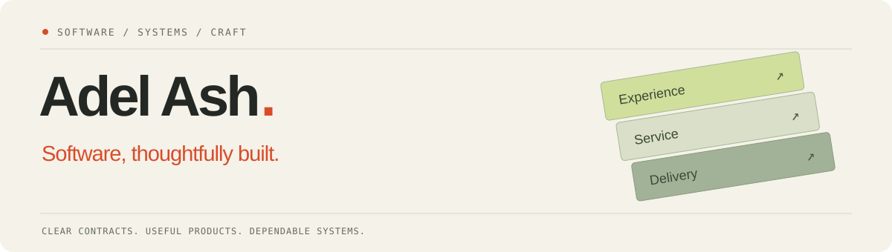

  <a href="https://adelash.vercel.app">Portfolio</a> ·
  <a href="mailto:tech.dev.workspace@gmail.com">Email</a> ·
  Indianapolis, IN

## Hi, I’m Adel 👋

I build useful software and dependable systems—from accessible product interfaces to APIs, asynchronous workflows and cloud delivery. My work spans enterprise SaaS, financial services and healthcare applications.

I care about clear contracts, data integrity, thoughtful interaction and recovery paths that are understandable when something goes wrong.

### How I approach the work

**Start with the workflow.** Understand the person using the system and the rules that make the result correct.

**Make the boundaries explicit.** Validate inputs, define ownership, preserve audit history and account for retries.

**Finish the delivery.** Include a clear setup, meaningful automated checks and an understandable operational path.

---

Thoughtful interfaces. Dependable services. Systems designed to work together.

